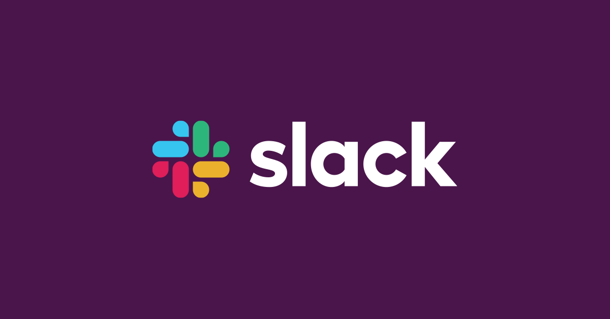
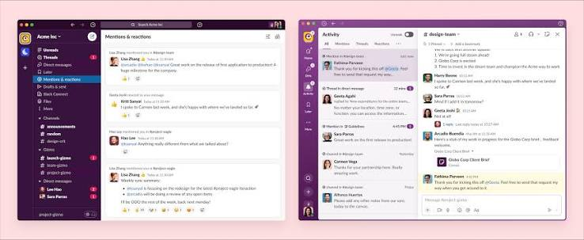
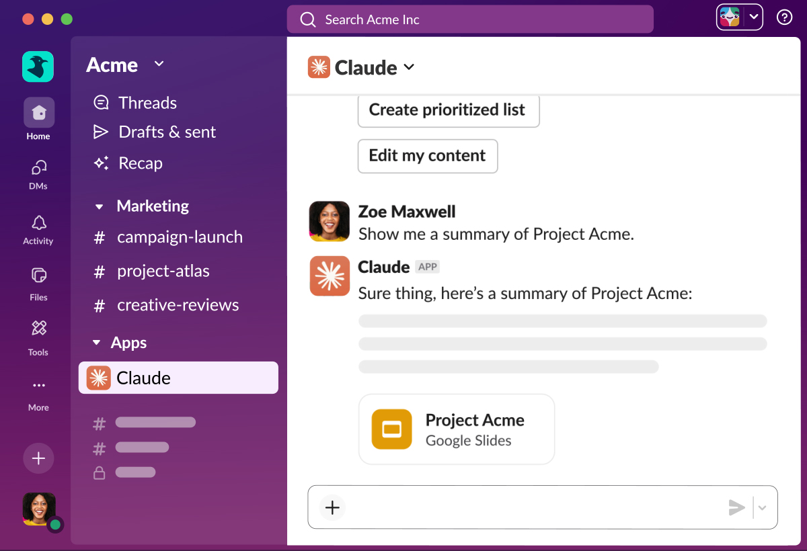

# Slack

Slack is a cloud workspace for business conversation, built by Salesforce. People keep work in persistent, topic-based channels instead of losing it in a private inbox.

Slack Chat is that room: public channels, private channels, and direct messages. A slack workspace is the account boundary around those rooms. slack AI, Agentforce, and Slackbot sit in the same window to summarize a channel, draft a reply, or search company data. A Slack Bot is also how a no-code workflow from Workflow Builder speaks up. No monthly price is stated here.

## Platform overview

One workspace replaces a pile of side chats. A channel holds a project, a department, or a topic. Slack Connect brings someone from outside the company into a channel without handing them the whole workspace.

* Public and private channels for work that should stay findable.
* Direct messages for a person or a small group.
* Huddles for live audio, video, screen share, and short clips.
* Slack AI and Agentforce for summaries, drafts, and search.
* Workflow Builder for steps that do not need a custom code project.
* More than 2,600 integrations, including Google Drive, Asana, Zoom, and Salesforce.

| Piece | What it is for |
| --- | --- |
| Channel | A topic that stays, public or private |
| Direct message | One person or a small group |
| Huddle | Live audio or video, plus screen share |
| Slack Bot | Summaries, drafts, and workflow steps |
| Integration | A third-party tool inside the workspace |

Channel membership and the channel record live in [channel.go](channel/channel.go) and `channels.go`. The list of channels a client can ask for is [channels.ts](channel/channels.ts) and [channelsList.ts](channel/channelsList.ts).

A message in that channel is [post.go](message/post.go). Search across messages is [messageSearch.ts](message/messageSearch.ts). The message helpers that decide what a highlight is are `messageContainsHighlight.ts`. A saved acknowledgement on a post is `post_acknowledgements.go`.

People return to a channel because the history stays. A new teammate can read the topic from the top instead of asking someone to forward a week of mail. That is the point of Slack Chat versus a chat that disappears.

Sidebar order is a convenience. The channel category file groups rooms so a project is not mixed with social noise. Bookmarks on a channel hold the doc or the ticket the room is about, so the link is not buried under replies.

## Trust and compliance

Sign in on the official Slack website. That is the account path for this app. A private channel stays off the public list. A direct message is not a channel everyone can join.

Slack 2FA is the extra check on that sign-in. Turn it on for the workspace account. This page does not invent a settings click-path. The official site is where account security is documented.

- [ ] Use the official website to create or open the workspace.
- [ ] Turn on 2FA for the account.
- [ ] Keep private work in a private channel.
- [ ] Use Slack Connect when the other person is outside the company.
- [ ] Do not install a copy from a random mirror.

External people belong in Slack Connect, not in a forwarded export of the whole history. If a channel should stay inside the company, leave it private.

Enterprise search terms show up around this product. They do not add a second app. A larger company still uses the same channels, the same huddles, and the same sign-in. What changes is admin control of who may create a public room and who may invite an outsider.

Status text is a small line on the person, not a channel. Use it for a meeting or an away note. It does not replace a message the team needs to find later.

## Native mobile and desktop apps

The same slack workspace opens on the web, in the desktop app, on iOS, and on Android. Setup and login go through the official site, which also links the iOS app. Desktop and Android are the other clients people use for the same account.

A huddle is the live call inside a channel or a direct message. You can talk, show a screen, or leave a short audio or video clip.

The incoming call view is [IncomingCall.tsx](huddle/IncomingCall.tsx). Call state for that view is [MediaCallProvider.tsx](huddle/MediaCallProvider.tsx). The section that hangs the call on a room is `MediaCallRoomSection.tsx`. Sounds for the call are `useCallSounds.ts`.

Clips are not a second product. They are a recording you send in the same conversation, when a live huddle is the wrong hour for the other person.

Screen share belongs in the huddle, not in a separate meeting link, when the people are already in the channel. If the group is larger than a quick call, still start from that channel so the notes stay next to the talk. A reminder can bring someone back at the right hour without a new room.

## Take the workspace

Create a workspace or sign in through the official Slack website. That is the only obtain path named for this app. This page does not point at a code host or a third-party download site.

### Running

After you are in, the first useful act is a channel, not a settings tour. Name it for the work. Invite the people who own that work. If someone outside the company must see one channel, use Slack Connect for that channel only.

Then try one huddle, one direct message, and one library workflow. Slack AI can summarize what the channel already said. A Slack Bot can post the workflow result into the same channel. Leave lookalike installers alone. This account is the Salesforce product on the official site.

A canvas in Slack is a doc that lives beside the channel, not a drawing of your desk. Use it when the decision needs a page, and keep the argument in the channel. Recurring reminders fire in the room so a standup does not depend on someone remembering to type.

If the client will not open, sign in on the web first. The web session tells you the password and the workspace name are right before you blame the desktop app. Updates come from that same official app.

A new workspace starts empty on purpose. Create the first channel for the work you actually have, then invite. Do not import a random export from another tool until that first channel is alive. Group chat is just a direct message with more than one person, still inside the same slack workspace.

Connecting the workspace record is [connectWorkspace.ts](workspace/connectWorkspace.ts). Starting that registration is `startRegisterWorkspace.ts`. A direct room is [direct.ts](workspace/direct.ts), and creating one is [createDirectRoom.ts](workspace/createDirectRoom.ts). Sending into that room is `sendDirectMessageToUsers.ts`.

## Learn more

slack API is how an outside tool posts into a channel, listens for an event, or opens a shortcut. A webhook is the small door for that post. Incoming webhook handling is [webhook.go](hook/webhook.go) and [webhooks.ts](hook/webhooks.ts). An action from an integration is `integration_action.go`. A slash-style command is [command.go](bot/command.go).

The bot user itself is [bot.go](bot.go). Bot settings are [bots.ts](bot/bots.ts). Storage for that bot is `bot_store.go`. Autocomplete for a command is `command_autocomplete.go`.

More than 2,600 tools can sit in the workspace. Google Drive, Asana, Zoom, and Salesforce are the named examples. An integration should post into a channel people already watch. It should not become a second inbox.

Workflow Builder is the no-code path. Use it when the step is a reminder, a form, or a handoff. Use the slack API when the step needs a real Slack Bot with its own logic. Both end in the same channel.

Analytics on a workspace, when an admin turns the view on, is about which channels carry the work. It is not a public scoreboard. Calendar and forms show up as integrations, the same way Drive and Zoom do. They do not replace the channel where the decision was written.

Agentforce is the agent side of slack AI: it can search enterprise data and help draft, inside the product Salesforce ships. It is not a separate chat you install beside this one.

A webhook should name the channel it posts to. If the post lands in the wrong room, fix the integration, do not make a second workspace. Voice in a huddle and a written decision in the channel are meant to stay paired.

A message body the client renders is [messages.ts](message/messages.ts). Root message types are `Message.ts`. Metadata on a post is `post_metadata.go`. Helpers around posting are `post_helpers.go`.

## Feature request

Ideas and bug notes go through the official Slack website, not through a code host and not through a repackaged installer. No in-app bug menu is specified here, so this page does not invent one.

If a huddle drops, a channel will not load, or Slack AI returns an empty summary, describe the workspace, the client (web, desktop, iOS, or Android), and what you clicked. Send that through official help. A forum thread is not the installer.

Channel categories in the sidebar are `channel_category.go`. Bookmarks on a channel are `channel_bookmark.go`. Guards on who may join are `channel_guards.go`. A lookup for an existing direct room is `findDirectRoomByIdentifier.ts`.

A feature you want, such as a richer reminder or a new integration, is the same door as a bug. Describe the outcome, not a guessed internal menu. Nonprofit, startup, and small-business plans are search topics around the product. This page does not state their prices. The official site is where a plan is chosen.

If Slack looks down, check the official status before you reinstall. A failed sign-in is often the workspace name or 2FA, not a broken desktop file. Reinstall only from the official site.

## Related Questions

### What is the Slack app used for?

Team conversation that stays. Channels for a topic, direct messages, Slack Connect for someone outside the company, huddles for a live call, and Slack AI or a Slack Bot for summaries, drafts, and workflows. More than 2,600 other tools can post into the same slack workspace. You open it from the official website.

It is not a ticket tracker by itself, and it is not a pants brand or a film. Project talk can live in a channel while the tracker stays an integration.

### How do I report bugs in Slack?

Through the official Slack website. No in-app bug button is specified here, so do not follow a guessed menu or a random download page. Say which client broke, which channel, and what you expected.

Include whether it was Slack Chat on the web or a desktop or phone client, and whether a Slack Bot or an integration was in the thread. That is enough for the official help path.

Do not send a workspace export to a stranger who offers to "fix" the client. Bug notes stay on the official site.

### What does the slang term "slack" mean?

In ordinary English it means loose, or to ease off. Trousers called slacks, and a movie, are different searches. This page is the Salesforce chat app: Slack Chat, channels, and a Slack Bot.

If a search result is about clothing or a film title, it is not this workspace. The app name and the ordinary word share spelling. The product is the one you open on the official website.

### Is Slack still used in 2026?

Yes. The product described here is the current Salesforce workspace, with Slack AI, Agentforce, huddles, Workflow Builder, and Slack Connect. This page does not invent a user count.

Huddles, canvas, and channel summaries are part of that current app, not a retired add-on. You still sign in on the official website.

A private channel, a huddle, and a Slack Bot summary are the three checks that the workspace is the current app and not an old export. Workflow Builder can post the reminder into the same channel the summary came from.

## Related Search Terms

Slack Chat, Slack Bot, slack AI, slack API, slack workspace, Topics: chat, messaging, collaboration, channels, bots, integrations, workspace, workflow, webhooks, huddles
